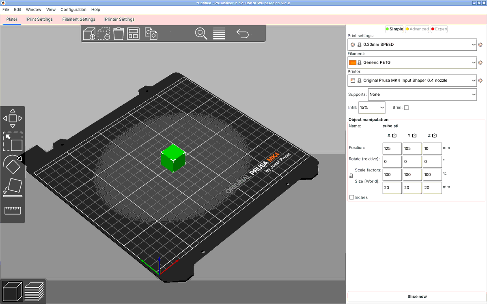
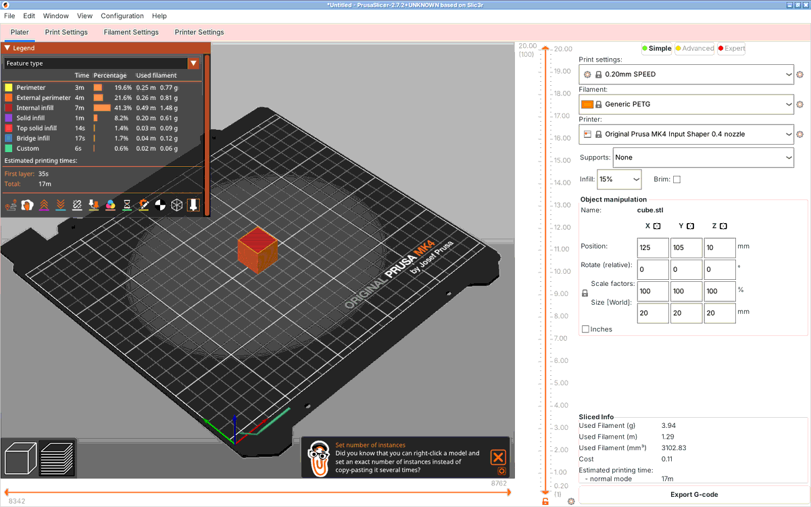
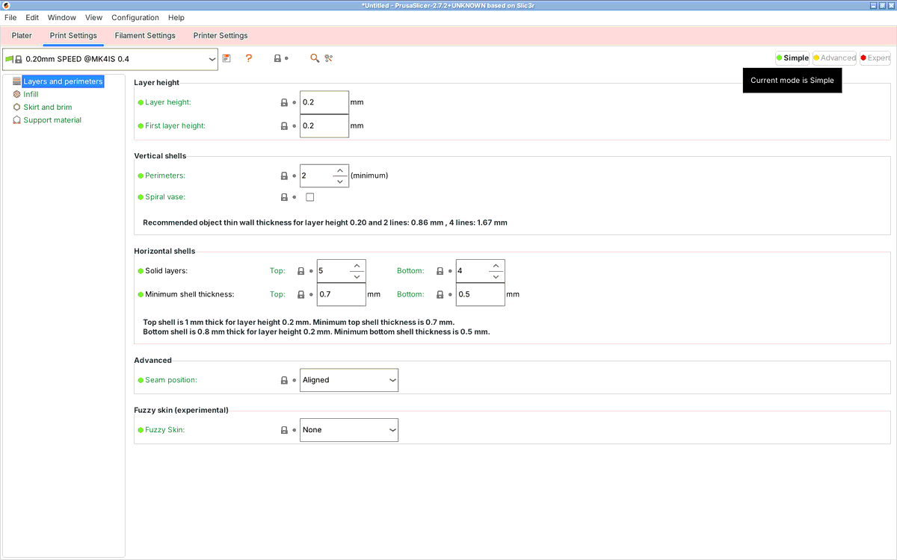

# Audit complet et plan — UI/UX, qualité de slicing, plateau, options

Date : 19 octobre 2026 · Base auditée : `main` @ `de7db7e` (0.3.0 build 3)

## Suivi d'implémentation (mise à jour après les phases 0 à 6 et le second passage « ce qui n'était pas fait »)

Légende : ✅ vérifié par une exécution (précisé) · 🟡 écrit et analysé (syntaxe + types du modèle/pont C
sous Linux) mais **non exécuté** : il manque macOS/Xcode ou un iPad · ⛔ non fait.

**Test de bout en bout du vrai modèle.** `scripts/e2e-linux.sh` compile le *vrai* `SlicerModel` et le *vrai*
pont C (`QSlicerCore`) avec des substituts minimaux de SwiftUI/UIKit, le lie au moteur Linux et déroule un
scénario complet (167 vérifications) : démarrage, presets, changement d'imprimante, import, déplacement,
annuler/rétablir, hors-plateau, organiser, rotation, poser sur une face, copies, échelle, alerte d'unités,
slicing, aperçu, réglages, préréglages, annulation du slicing, relance de l'app, export/import de profil,
calibrations, multi-sélection, outils d'objet, multi-filament / QIDI Box, découverte réseau. **Il a trouvé cinq vrais bugs** qu'aucune lecture n'avait vus :
(1) `undo()` plantait à la première utilisation (violation d'exclusivité d'accès Swift : deux `inout`
croisés sur les piles d'annulation) ; (2) le filament choisi n'était **pas appliqué** à la configuration
(avec un seul extrudeur `PresetBundle::full_config()` lit la collection, pas la sélection par extrudeur) ;
(3) à la première utilisation le filament par défaut n'était jamais proposé (valeur mémorisée lue après
avoir été écrasée) ; (4) l'export `.ini` pouvait omettre un réglage saisi à l'instant (course avec la
synchronisation différée) ; (5) une plage de hauteurs sans `layer_height` (créée par la calibration du débit
volumétrique) faisait **planter le moteur** : `layer_height_profile_from_ranges` déréférence un pointeur nul — le
moteur complète désormais chaque plage comme le fait le bureau. Tous corrigés, avec un contrôle dans la gate
pour les n° 2 et 5.

**Ce que « vérifié » veut dire ici.** J'ai compilé le moteur (libslic3r + notre ABI) sous Linux et exécuté
les gates contre le vrai bundle QIDI : `scripts/linux-engine.sh`. Ce banc reproduit exactement les chiffres
de la gate macOS (8 100 lignes, 6 757 mouvements, 100 couches, 1 397,9 mm). Il ne couvre pas Xcode, le SDK
iOS, SwiftUI/SceneKit ni l'appareil : les vues sont en 🟡, la CI `ios-app` et la recette iPad les jugeront.

| Bug | État | Preuve |
|---|---|---|
| B1 aperçu perdait ~63 % des trajectoires (M83) | ✅ supprimé à la source | l'aperçu n'analyse plus le texte : il lit les mouvements calculés par le moteur (`qsid_gcode_moves`) ; test de non-régression sur le parseur retiré remplacé par la gate (30 006 mouvements, rôles et couches cohérents) |
| B2 `ensure_on_bed` absent | ✅ | gate : cubes décalés de +30 et −5 mm en Z → G-code **identique** au cube posé (hôte) ; scène : « posé sur le plateau (Z min = 0) » |
| B3 écran/arrière-plan hors du slicing | 🟡 | `KeepAwake` dans `slice()` (typecheck) |
| B4 `current_print` pendant l'annulation | ✅ (analyse) 🟡 (exécution de l'annulation) | garde RAII ; ASan/UBSan sur notre code sans erreur |
| B5 sélection non persistée | 🟡 | `didSet` + restauration en deux temps (typecheck) |
| B6 filament d'une autre imprimante | ✅ | le moteur remplace les presets incompatibles ; l'app filtre par variante de buse (tests Swift sur la sortie réelle du moteur) |
| B7 options imposées | ✅ | modèle « valeurs forcées » : 8 tests Swift, dont l'état hérité d'une ancienne version |
| B8 vignettes | ✅ moteur · 🟡 rendu SceneKit | gate : le moteur écrit 272×272 et 96×96 depuis le fournisseur de l'hôte, orientation vérifiée |
| B9 `onOpenURL` | 🟡 | |
| B10 normales / ombrage | 🟡 | |
| B11 troncature de l'aperçu à 2 000 couches | ✅ | plus de plafond de couches ; au-delà de 1,5 M segments le remplissage interne est omis *et le dit* |
| B12 ré-organisation à chaque slicing | ✅ | la scène conserve les positions ; placement à la « première place libre » |
| B13 légende des gestes | 🟡 | |
| B14 progression non ordonnée | 🟡 | relais à 10 Hz, dernière valeur seulement |

**Correction de l'audit.** J'ai écrit que le sélecteur de filaments listait 858 entrées. C'est le nombre de
*sections* du bundle ; pour une imprimante donnée il y a ~43 filaments distincts (le moteur liste toutes les
variantes de buse du modèle, l'app ne garde que celles de l'imprimante choisie).

| Phase | État |
|---|---|
| 0 correctifs | cf. tableau ci-dessus |
| 1 ABI scène/presets/slicing incrémental | ✅ 35 fonctions C (24 + coupe, simplification, réglages par objet, modificateurs, plages, multi-filament), gate de scène (178 vérifications) verte sur le vrai moteur et le vrai bundle ; `PresetBundle` remplace la résolution Swift ; `Print` conservé entre slicings |
| 2 plateau et manipulation | ✅ logique (rayons, caméra, aimantation, poser sur une face, hors-plateau, sélection de groupe, plan de coupe : tests Linux + moteur) · ✅ coupe, simplification, multi-sélection (annuler en un pas, déplacement de groupe) exécutées contre le vrai moteur · 🟡 vue SceneKit, gestes, menu contextuel (appui long), inspecteur. Fait : plateau + volume + socle QIDI, sélection **multiple** et ⌘A, glisser (un objet ou tout le groupe), rotation à deux doigts, caméra, champs numériques, copies, organiser, centrer, orientation d'origine, annuler/rétablir, conversion d'unités, clavier, **menu contextuel par appui long / clic droit**, **coupe par plan** (plan visible sur le plateau, axes X/Y/Z, garder un côté, face coupée à plat), **simplification de maillage** |
| 3 aperçu G-code | ✅ construction de la géométrie (tests) · 🟡 rendu : rubans à la largeur/hauteur réelles, 7 modes de couleur, légende (durée, %), masquage par type, déplacements, double curseur de couches, curseur de mouvements, lecture |
| 4 réglages | ✅ schéma du moteur + disposition des onglets de `Tab.cpp` (306 options, 19 pages, **toutes présentes dans le schéma**) + 1 433 traductions du bureau, Simple/Avancé/Expert, recherche · ✅ **réglages par objet, modificateurs (boîte, cylindre, sphère), bloqueurs / forceurs de supports et plages de hauteurs** exécutés contre le vrai moteur (le remplissage d'un objet ou d'un modificateur change réellement le filament consommé ; 152 options acceptées par objet, les autres refusées) · ✅ **préréglages qui héritent** d'imprimante / impression / filament de départ, avec indicateur « modifié », « mettre à jour » et « enregistrer sous » · 🟡 vues. Fait aussi : modifié/retour au preset, paramètres fréquents, export `.ini` |
| 5 spécificités QIDI | ✅ vignettes (moteur) · ✅ calibrations Pressure Advance (tour, **ligne**, **motif**), débit (grossier/fin) et **débit volumétrique maximal** exécutées (G-code vérifié : valeurs de K, 14 plages de vitesses croissantes, un mur de 15 couches) · ✅ **multi-filament** : 1 à 16 extrudeurs, un filament par extrudeur, changements d'outil (`T1`) dans le G-code, aperçu par filament · ✅ **QIDI Box** : mêmes commandes Klipper que le bureau, vérifiées contre un Moonraker simulé (écriture et relecture des variables) · ✅ **découverte réseau** : balayage de sous-réseau et sonde `/server/info` testés contre le Moonraker simulé · 🟡 Bonjour (Network.framework, non exécutable sous Linux), envoi Moonraker réel. **Limites** : la lecture automatique du contenu du Box (couleur, matière) passe par un module réseau fermé absent des sources — non portée ; la correspondance des numéros d'emplacement avec le matériel n'a pas pu être confirmée ; les étiquettes numériques des calibrations PA (maillage de texte) sont remplacées par une légende |
| 6 qualité continue | ✅ 91 tests Swift sous Linux (décodage de sorties **réelles** du moteur), typecheck du modèle et du pont C, gate de scène, contrôle des traductions (`scripts/tests/l10n_keys.py`), job CI `swift-tests` (sans minutes macOS), banc Linux du moteur |

**Anomalies amont observées (non corrigées, sans effet sur les résultats)** : le bundle QIDI met
`extruder_clearance_*` dans des presets d'impression (le moteur les retire en journalisant une erreur par
preset) ; la macro `TIMELAPSE_TAKE_FRAME` est lue comme un changement d'outil par `GCodeProcessor`
(une erreur journalisée par couche) ; un `assert` de `Wipe.cpp` échoue dans une build avec assertions
(désactivées en Release, comme sur les builds livrées).

---

## 0. Méthode et référence « vraie app »

- **Code de l'app lu en entier** : ABI C (`core/`), Swift (`ios/QSlicerPad/**`), scripts, CI, docs.
- **Sources QIDISlicer 1.2.5** clonées à la révision épinglée (`988f419`, la même que `QSID_REV`) :
  GUI (`src/slic3r/GUI` : `Plater`, `Sidebar`, `Tab`, `GLGizmo*`, `GCodeViewer`, `FrequentlyChangedParameters`,
  `calib_dlg`), CLI (`src/CLI`) et moteur (`src/libslic3r`), bundle `resources/profiles/QIDITechnology.ini`.
- **GUI de bureau exécutée** : le proxy de cette session refuse le téléchargement des binaires de release
  QIDI (HTTP 403). J'ai donc lancé **PrusaSlicer 2.7.2** (paquet Ubuntu ; QIDISlicer en est un fork, même
  ossature d'interface) sous Xvfb, importé le cube de `testdata/`, slicé, et capturé les écrans ci-dessous.
  Les éléments propres à QIDI (barre supérieure, onglet appareil web, synchro QIDI Box, menu Calibration)
  sont relevés dans les sources, pas à l'écran.
- **Mesures reproductibles** : un G-code réel en extrusion relative (comme tous les profils QIDI) a été
  généré, et le parseur Swift de l'aperçu a été rejoué en Python à l'identique (bug B1).

| Préparer (plateau + manipulation d'objet) | Aperçu G-code (légende, curseurs, stats) | Réglages (Simple/Avancé/Expert) |
|---|---|---|
|  |  |  |

Ce que montre l'app de bureau et qui structure tout le plan :

1. **Le plateau 3D est l'écran principal** : plateau réel de l'imprimante (STL + texture SVG du bundle), objets
   posés dessus et sélectionnables, barre de gizmos à gauche (déplacer, échelle, rotation, poser sur une face,
   couper, peindre supports/couture…), barre d'outils (ajouter, supprimer, **organiser**, copier/coller,
   instances, annuler/rétablir).
2. **Barre latérale droite** : trois sélecteurs de presets (impression, filament, imprimante) + **paramètres
   fréquents** (supports : aucun / sur le plateau uniquement / renforts uniquement / partout ; remplissage ;
   bordure), puis la **manipulation d'objet** (position, rotation, échelle, taille en mm, pouces) et, après
   slicing, les **infos** : filament en g/m/mm³, coût, durée estimée. Un seul bouton, « Slicer » puis
   « Exporter le G-code ».
3. **Aperçu** : légende par type d'extrusion avec durée, %, filament par type ; double curseur de couches
   vertical, curseur de mouvements horizontal, vues par vitesse/hauteur/largeur/ventilateur/température/débit.
4. **Réglages** : pages et groupes (Couches et périmètres, Remplissage, Jupe et bordure, Supports, Vitesse…),
   trois niveaux (Simple/Avancé/Expert), cadenas « valeur système » et flèche « modifié » par option,
   recherche, textes d'aide calculés (« la coque supérieure fait 1 mm… »).

---

## 1. Synthèse

Le socle est solide : moteur réel compilé pour iOS, G-code identique octet pour octet à la CLI, CI
économe. Mais l'app est aujourd'hui **un formulaire qui appelle le moteur**, pas un slicer : pas de
plateau, pas d'objet manipulable, un aperçu G-code qui **perd ~63 % des trajectoires** sur les profils
QIDI, et une préparation du modèle qui reprend la CLI **sans `ensure_on_bed`**. L'ABI est sans état
(fichier en entrée, fichier en sortie), ce qui interdit tout ce que demande la suite (déplacer un objet,
re-slicer vite, afficher des statistiques) : **c'est le premier verrou à lever**.

---

## 2. Bugs confirmés (à corriger d'abord)

| # | Gravité | Où | Constat | Effet |
|---|---|---|---|---|
| B1 | **Haute** | `Core/GCodePreview.swift:37,67-68` | Le parseur ignore `M83`/`M82`. Tous les profils QIDI ont `use_relative_e_distances = 1` (`[printer:*common*]`) : chaque `E` relatif est comparé au précédent comme s'il était absolu. | **Mesuré : 1 226 segments tracés sur 3 352 extrudés (36,6 %)** sur un cube. L'aperçu montre des trous qui n'existent pas dans le G-code. Avec `M83` pris en compte : 100 %. |
| B2 | **Haute** | `core/src/qidislice.cpp` (pas d'appel à `ensure_on_bed`) | La CLI amont pose chaque objet sur le plateau (`CLI/ProcessTransform.cpp:202-205`) ; l'ABI ne fait que `arrange_objects`, qui ne touche pas Z. | Un STL dont le Z min ≠ 0 est imprimé **en l'air** ou **coupé sous le plateau**. La gate ne le voit pas : le cube de test est déjà à Z=0. |
| B3 | **Haute** | `Model/SlicerModel.swift:258` vs `:290` | Écran maintenu éveillé + tâche d'arrière-plan sont placés dans `loadMesh` (conversion STL), **pas** dans `slice()`. | Pendant un slicing long, l'iPad se verrouille et iOS suspend l'app. La recette « l'écran ne s'éteint pas » échouera. |
| B4 | Moyenne | `qidislice.cpp:167,221-228` | `current_print` pointe vers un `Print` sur la pile ; les retours anticipés (`validate`, `empty`, annulation avant `process`) ne le remettent pas à `nullptr`. | Un `qsid_cancel()` ultérieur déréférence un objet détruit (use-after-free). Corriger avec un garde RAII. |
| B5 | Moyenne | `SlicerModel.swift:159` | `persistSelection()` n'est **jamais appelé**. | Imprimante, réglages et filament reviennent au premier de la liste à chaque lancement (« Q1 Pro 0.2 nozzle »). |
| B6 | Moyenne | `SlicerModel.swift:18` | Changer d'imprimante remet le preset d'impression mais **pas le filament**. | On peut slicer une X-Plus 3 0.6 avec un filament `@Q2 0.4 nozzle` (températures, débit max…) ; le sélecteur apparaît vide alors que la valeur est utilisée. |
| B7 | Moyenne | `Core/SliceOverrides.swift` | Activer les options **impose** `fill_density = 15 %` et `brim_width = 0`/`raft_layers = 0`, même si l'utilisateur ne voulait que les supports ; les valeurs ne partent pas du preset ; `layer_height` n'est pas confronté aux limites de la buse (0,28 mm sur une buse 0,2 → échec de validation) ; le décalage de température est ignoré en silence si la valeur est multiple (`"220,220"`). | Résultats différents de ceux attendus, sans le signaler. |
| B8 | Moyenne | `qidislice.cpp:244` | Liste de vignettes vide. Le bundle demande `380x380/QIDI, 210x210/QIDI, 110x110/PNG` (X-Plus 3, X-Max 3), `205x205/QIDI…` (X-Smart 3), `272x272/PNG…` (X-Plus 4), `160x160/PNG…` (Q1 Pro). | L'écran de l'imprimante n'affiche pas d'aperçu du fichier. L'encodage QIDI existe déjà dans le moteur (`GCode/Thumbnails.hpp`) : il suffit de fournir les pixels RGBA. |
| B9 | Moyenne | `Resources/Info.plist:60` | `CFBundleDocumentTypes` est déclaré, mais aucune vue ne gère `onOpenURL`. | « Ouvrir dans QSlicerPad » depuis Fichiers/Mail lance l'app **sans importer** le fichier. |
| B10 | Moyenne | `Core/STLLoader.swift:101` | Géométrie sans source de normales, éclairage `physicallyBased`. | Le modèle est rendu sans ombrage lisible (faces de même teinte). |
| B11 | Basse | `GCodePreview.swift:28` | `maxLayers = 2000` tronque en silence. | À 0,08 mm, l'aperçu s'arrête à 160 mm (X-Max 3 : 315 mm de hauteur). |
| B12 | Basse | `qidislice.cpp:201` | `arrange_objects` est appelé à chaque slicing. | La disposition d'un 3MF est perdue, et le futur déplacement manuel serait écrasé. |
| B13 | Basse | `Screens/ViewerScreen.swift:42` | La légende dit « Deux doigts : orbite » ; SceneKit fait l'orbite à **un** doigt (deux doigts = panoramique). | Consigne fausse (la recette dit « un doigt »). |
| B14 | Basse | `SlicerModel.swift` (`Task { @MainActor … }` par callback) | Les mises à jour de progression ne sont pas ordonnées et peuvent arriver après « Terminé ». | Pourcentage qui recule ou texte périmé. |

---

## 3. Qualité de slicing : où l'app s'écarte du bureau

Le moteur est le même, mais **ce qui l'entoure diffère**. Le G-code identique à la CLI est acquis ; il
faut maintenant qu'il soit identique **à l'export de la GUI** pour un même modèle et un même preset.

| Sujet | Bureau | App aujourd'hui | Cible |
|---|---|---|---|
| Préparation du modèle | `ensure_on_bed`, détection pouces/mètres (`LoadStats`), objet multi-pièces, objets de volume nul supprimés, réparation signalée | `load_model` sans `stats`, aucun `ensure_on_bed` | Reproduire la séquence de `Plater::load_files` dans l'ABI, et remonter les alertes (pouces, réparations) à l'UI |
| Presets | `PresetBundle` : héritages, **conditions** `compatible_printers_condition` (`printer_model=="Q2" and nozzle_diameter[0]==0.4`), clés `*_settings_id` | Résolution Swift + filtre sur le suffixe `@imprimante` (marche pour le bundle actuel, pas pour un preset utilisateur ni un futur bundle) | Utiliser `PresetBundle` de **libslic3r** (il n'est pas dans la GUI) via l'ABI : même résolution, mêmes compatibilités, même `full_config()` |
| Disposition | Positions conservées ; « Organiser » à la demande | Ré-organise toujours | Transformations venues de l'app ; `arrange` seulement sur demande ou à l'import |
| 3MF projet | Réglages par objet, modificateurs, couches variables, peinture supports/couture | Géométrie seulement | Conserver ce que `read_model_from_file` charge déjà ; proposer « utiliser les réglages du projet » |
| Nom de fichier | `output_filename_format` (`[input_filename_base].gcode` chez QIDI, mais modifiable) | Nom du modèle | `Print::output_filepath()` |
| Statistiques | Durée (normal/silencieux), par type, filament g/m/mm³, coût | Lignes/couches/taille/durée de calcul | Résumé du `GCodeProcessorResult` (déjà calculé par `do_export`, il suffit de passer un résultat non nul) |
| Avertissements | Notifications (couche vide, objet trop haut, extrusion fine…) | Seul le message de `validate()` | Remonter les `PrintStateBase` warnings via le callback de statut |
| Re-slicing | Incrémental (`Print::apply` invalide seulement les étapes touchées) | Nouveau `Print` à chaque fois | `Print` persistant dans le contexte : changer la température ne refait que l'export |
| Vignettes | Rendues et encodées (QIDI/PNG) | Aucune | Rendu Swift (Metal/SceneKit snapshot) → RGBA → moteur |

**Validation proposée** (critère de sortie de la phase 1) : 3 modèles (cube, pièce mécanique avec
surplombs, 3MF multi-objets) × 3 imprimantes (Q2 0.4, X-Plus 3 0.4, X-Max 3 0.6) exportés depuis
QIDISlicer **bureau** puis depuis l'app → diff après retrait des lignes d'horodatage. À ajouter à la gate
hôte : elle sait déjà comparer deux G-code.

---

## 4. Audit UI/UX

### 4.1 Ce qui est bien
Cibles ≥ 44 pt, deux colonnes sur iPad, glisser-déposer, raccourcis clavier, haptiques, états vides,
feuilles avec « Terminé », mode sombre par les couleurs système, FR/EN.

### 4.2 Ce qui manque ou gêne

1. **Pas de plateau.** Le modèle s'affiche dans une feuille, à ses coordonnées de fichier, sans plateau ni
   volume d'impression ; la position réelle (après organisation) n'est jamais montrée. Impossible de
   sélectionner, déplacer, tourner, dupliquer un objet.
2. **Parcours en formulaire.** Profil → modèle → slicer → résultat sont des sections de liste ; l'utilisateur
   ne voit jamais *ce qui va être imprimé* avant d'ouvrir une feuille. Sur le bureau, tout part du plateau.
3. **Sélecteur de 858 filaments** dans un menu déroulant : inutilisable au doigt. Pas de recherche, pas de
   regroupement par marque/type, pas de favoris (le bureau a « filaments installés » dans l'assistant).
4. **Options de slicing** : un interrupteur global « Utiliser ces options » qui grise tout, des valeurs qui
   ne montrent pas celles du preset, aucune indication de ce qui a été modifié, 9 réglages sur ~300.
   Pas d'aide sur les options. Les supports n'ont pas les choix du bureau (sur le plateau uniquement, style
   organique/grille, renforts).
5. **Doublons** : les sélecteurs de profil existent dans la barre latérale **et** dans Réglages ; « À propos »
   apparaît deux fois ; la section « Moteur » occupe le haut du détail sans servir à l'usage.
6. **Erreurs** : texte rouge en bas de liste, souvent hors écran ; pas de bannière ni d'action proposée
   (« objet hors du plateau → Organiser »).
7. **Aperçu G-code** : une seule couleur, traits de 1 px, pas de légende, pas de type d'extrusion, pas de
   déplacements à vide, reconstruction complète de la géométrie à chaque relâchement du curseur, pas de
   durée estimée.
8. **Nom** : « QIDI Slice » dans l'app, « QSlicerPad » ailleurs.

### 4.3 Dette technique qui bloque la suite

- `SceneView` (SwiftUI) ne donne la main ni sur les gestes ni sur la cible de la caméra : impossible d'y
  faire de la sélection ou du glisser d'objet. Il faut un `SCNView` (ou RealityKit) en `UIViewRepresentable`.
- ABI sans état : chaque appel recharge le modèle et recrée le `Print`.
- `qsid_export_stl` passe par la CLI et **fusionne** tous les objets en un seul STL.
- Le Swift n'a aucun test exécuté : les miroirs Python (`slice_overrides.py`) peuvent dériver. Les parseurs
  purs (profils, G-code, STL) peuvent vivre dans un paquet SwiftPM sans SceneKit, testable sur un runner
  **Linux** (gratuit), ce qui ménage le quota macOS.
- `L10n` traduit à la main ; le bundle amont contient `resources/localization/fr/QIDISlicer.mo` avec les
  libellés et aides **de toutes les options** — à réutiliser pour l'écran des réglages.

---

## 5. Plan

Chaque phase a un critère de sortie vérifiable, comme dans `docs/roadmap.md`. L'ordre compte : la phase 1
(ABI à état) conditionne le plateau, l'aperçu riche et les options.

### Phase 0 — Correctifs rapides (aucune nouvelle fonctionnalité)

| Tâche | Bug | Critère de sortie |
|---|---|---|
| Gérer `M82`/`M83` (et `G92 E`) dans `GCodePreview` ; compter les couches sans plafond silencieux (échantillonner au lieu de tronquer) | B1, B11 | Test Python miroir : 100 % des segments extrudés sur un G-code en `M83` (la mesure ci-dessus devient un test du lint) |
| `ensure_on_bed` pour chaque objet après chargement, comme la CLI | B2 | Gate : un STL décalé à Z=+30 donne le même G-code que le même STL à Z=0 |
| Déplacer écran éveillé + tâche d'arrière-plan dans `slice()` | B3 | Recette §5 |
| Garde RAII sur `current_print` | B4 | Gate ASan : annulation après un échec de validation |
| Appeler `persistSelection()` (via `didSet` ou `onChange`) ; défaut sur une buse 0,4 | B5 | Sélection conservée après redémarrage |
| Recalculer le filament (et le preset) compatible au changement d'imprimante | B6 | Plus de filament `@autre imprimante` dans le `.ini` généré |
| Options : chaque option devient « héritée du preset » ou « forcée » (pas d'interrupteur global) ; valeurs initiales lues dans le preset résolu ; contrôle des limites de hauteur de couche | B7 | `slice_overrides.py` étendu : aucune clé écrite si l'utilisateur n'a rien changé |
| `onOpenURL` → import | B9 | « Ouvrir dans… » depuis Fichiers importe le modèle |
| Normales par face dans `STLLoader` ; légende des gestes corrigée | B10, B13 | Capture du simulateur |
| Progression : ne garder que la dernière valeur (coalescence) | B14 | — |

### Phase 1 — ABI « scène » (moteur) : le verrou

Remplacer le couple « fichier → G-code » par une session qui garde `Model`, `PresetBundle` et `Print` en mémoire.

```c
/* Scène */
int  qsid_scene_load(ctx, path, opts, out_json)          /* objets, instances, bbox, alertes (pouces, réparations, multi-pièces) */
int  qsid_scene_mesh(ctx, object_id, out_vertices, out_indices)   /* par objet : plus de STL fusionné */
int  qsid_scene_set_transform(ctx, object_id, instance, mat4)
int  qsid_scene_add_instance / remove / duplicate / delete_object
int  qsid_scene_arrange(ctx, opts)                        /* à la demande */
int  qsid_scene_lay_on_face(ctx, object_id, face_index)   /* logique de GLGizmoFlatten */
int  qsid_scene_ensure_on_bed / center / scale_to_fit
/* plus tard : découpe (CutUtils), simplification (QuadricEdgeCollapse), séparation en objets/pièces */

/* Presets (PresetBundle de libslic3r) */
int  qsid_presets_load_vendor(ctx, ini_path)
int  qsid_presets_list(ctx, kind, compatible_only, out_json)   /* conditions évaluées par le moteur */
int  qsid_presets_select(ctx, printer, print, filament)
int  qsid_config_set(ctx, key, value)  /  qsid_config_diff(ctx, out_json)   /* écarts au preset système */
int  qsid_config_schema(ctx, out_json)  /* PrintConfigDef : type, libellé, aide, unité, min/max, énumérations, mode Simple/Avancé/Expert */

/* Slicing incrémental */
int  qsid_slice_scene(ctx, out_gcode, progress_cb, thumbnail_cb, user, out_summary_json)
     /* summary : durées normal/silencieux et par type, filament g/m/mm³, coût, avertissements, nom de sortie */
int  qsid_gcode_moves(ctx, out_buffer)  /* mouvements du GCodeProcessorResult : position, type, largeur, hauteur, vitesse, ventilo, température, temps */
```

- Rester **C pur** (tampons + JSON) : le contrat Swift reste simple et testable.
- La gate hôte s'étend à la scène : charger, déplacer, re-slicer, comparer.
- **Critère de sortie** : le diff « bureau vs app » du §3 passe pour les 9 combinaisons ; un changement de
  température seule re-slice sans refaire `process()` (vérifié par la progression).

### Phase 2 — Plateau 3D et manipulation d'objets (« Préparer »)

**Disposition iPad (paysage)** — calquée sur le bureau, adaptée au doigt :

```
┌───────────────────────────────────────────────────────────────┬──────────────────────┐
│ [Préparer | Aperçu]           ⟲ ⟳   ＋ Importer   ⊞ Organiser   │ Imprimante  ▾        │
│ ┌──┐                                                            │ Impression  ▾        │
│ │✥ │  déplacer                                                  │ Filament    ▾ (🔍)   │
│ │⟳ │  tourner            PLATEAU 3D (STL + SVG du bundle QIDI)  │ ──────────────────── │
│ │⤢ │  échelle            objets sélectionnables                 │ Supports  ▾          │
│ │▭ │  poser sur une face  hors plateau = rouge                  │ Remplissage  15 % ▾  │
│ │✂ │  couper (plus tard)                                        │ Bordure  ☐           │
│ │⧉ │  instances                                                 │ ──────────────────── │
│ └──┘                                                            │ Objets (liste)       │
│                                    [Dessus][Face][Iso][Recadrer]│ Position X Y Z (mm)  │
│                                                                 │ Rotation · Échelle   │
│                                                                 │ ──────────────────── │
│                                                                 │ [   Slicer   ⌘↩   ]  │
└───────────────────────────────────────────────────────────────┴──────────────────────┘
```

En portrait / Split View étroite : l'inspecteur devient une feuille à crans (`presentationDetents`) au-dessus
du plateau, le bouton Slicer reste visible.

- **Rendu** : `SCNView` en `UIViewRepresentable` (contrôle total des gestes) ; plateau = `bed_model` +
  `bed_texture` des sections `[printer_model:…]` (présents pour les 6 modèles QIDI ; attention, le bundle
  référence `X-Plus 4_bed.stl` et `Q1 Pro_bed.stl` alors que les fichiers sont en `.STL` : résoudre sans
  tenir compte de la casse) ; grille ; volume d'impression en
  fil de fer (`bed_shape`, `max_print_height`) ; ombrage avec normales ; surbrillance de sélection.
- **Gestes** (sans conflit avec la caméra) :
  - toucher un objet → sélection ; toucher le vide → désélection ;
  - **glisser un objet sélectionné** → déplacement sur le plan Z=0 (raycast sur le plan, pas sur le maillage),
    aimantation à la grille et au centre avec retour haptique ;
  - **rotation à deux doigts** sur l'objet sélectionné → rotation autour de Z (pas de 15° aimanté) ;
  - glisser dans le vide → orbite ; deux doigts → panoramique ; pincement → zoom ;
  - appui long → menu contextuel : dupliquer, instances (nombre exact), supprimer, poser sur une face,
    centrer, réinitialiser la transformation, mettre à l'échelle pour tenir ;
  - clavier : flèches = déplacement de 1 mm (⇧ = 10 mm), ⌫ = supprimer, ⌘D = dupliquer, ⌘Z/⇧⌘Z,
    ⌘A = tout sélectionner, A = organiser (comme le bureau).
- **Saisie précise** : champs X/Y/Z, rotation, échelle (%), taille (mm) avec cadenas d'uniformité — le
  panneau « Manipulation d'objet » du bureau.
- **Annuler/rétablir** via `UndoManager` (chaque transformation est une commande vers l'ABI).
- **Poser sur une face** : mode où l'on touche une face du maillage (hit-test SceneKit → index de face) ;
  le calcul suit `GLGizmoFlatten` (faces de l'enveloppe convexe).
- **Critère de sortie** : importer deux STL, en déplacer un au doigt, en tourner un de 90°, slicer → le G-code
  place les objets là où ils sont affichés (vérifié dans l'aperçu et par les coordonnées).

### Phase 3 — Aperçu G-code de niveau bureau

- Données issues de `qsid_gcode_moves` (plus de parsing de texte côté Swift) : position, **type d'extrusion**,
  largeur, hauteur, vitesse, ventilateur, température, temps.
- Rendu : rubans (quads orientés, largeur réelle) en un seul tampon Metal/SceneKit, plages d'index par couche
  construites **une fois** ; changer de couche = changer la plage dessinée (plus de reconstruction).
- Couleurs par type (palette du bureau), vitesse, hauteur, largeur, ventilateur, température, débit volumique.
- Légende repliable : durée, %, filament par type ; bascules par type, déplacements à vide, rétractions, coutures.
- **Double curseur** de couches (min/max) vertical + curseur de mouvements dans la couche, lecture animée.
- Panneau de résultat : durée estimée, filament (g, m), coût, puis Partager / Envoyer à l'imprimante.
- **Critère de sortie** : un G-code de 100 Mo se parcourt couche par couche sans saccade sur iPad, mémoire
  bornée (mesurée).

### Phase 4 — Affichage des options (parité bureau)

- **Écran de réglages généré** depuis `qsid_config_schema` : pages et groupes repris de `Tab.cpp` (extraits
  par script en JSON versionné, vérifié par le lint), trois niveaux Simple/Avancé/Expert, **recherche**.
- Par option : valeur, unité, aide (popover), **indicateur « modifié par rapport au preset »** et bouton
  « revenir à la valeur du preset » — l'équivalent du cadenas/flèche du bureau.
- Libellés et aides en français tirés de `QIDISlicer_fr.po` (des milliers de chaînes déjà traduites).
- **Paramètres fréquents** sur l'écran principal, identiques au bureau : supports (aucun / sur le plateau
  uniquement / renforts uniquement / partout), remplissage, bordure.
- **Filaments** : recherche, regroupement par marque et type, favoris (« mes filaments »), compatibilité
  évaluée par le moteur.
- **Presets utilisateur** : enregistrer sous (héritant du preset système), exporter/importer en `.ini`.
- Plus tard : réglages par objet et modificateurs (déjà portés par le `Model`).
- **Critère de sortie** : toute option du bureau en mode Expert est trouvable par recherche et modifiable ;
  le `.ini` effectif est exportable et ré-importable sans perte.

### Phase 5 — Spécificités QIDI

- **Vignettes** (B8) : rendu de la scène aux tailles demandées par `thumbnails`, encodage QIDI/PNG par le
  moteur. Critère : l'écran de l'imprimante affiche l'aperçu du fichier.
- Moonraker : progression d'envoi, file d'attente, état temps réel ; découverte réseau à étudier (annonce
  mDNS des imprimantes QIDI à vérifier sur appareil).
- Calibration (menu du bureau : débit, Pressure Advance, débit volumique max) : génération de modèles de test.
- QIDI Box (multi-filament) : après le multi-extrudeur dans l'ABI.

### Phase 6 — Qualité continue

- Paquet SwiftPM `QSlicerKit` (profils, G-code, STL, options) testé sur runner **Linux** à chaque push.
- Gate hôte : comparaison bureau vs app (phase 1), cas Z≠0, annulation, scène.
- Recette iPad (`docs/recette-ipad.md`) étendue au plateau et à l'aperçu ; captures simulateur quand le job
  `ui-snapshot` sera débloqué.

### Ordre recommandé et effort relatif

| Ordre | Phase | Effort | Dépend de |
|---|---|---|---|
| 1 | Phase 0 — correctifs | S | — |
| 2 | Phase 1 — ABI scène + presets moteur | L | 0 |
| 3 | Phase 2 — plateau et manipulation | L | 1 |
| 4 | Phase 4 — options (paramètres fréquents d'abord, écran généré ensuite) | M | 1 |
| 5 | Phase 3 — aperçu riche | M | 1 |
| 6 | Phase 5 — vignettes puis le reste | S → L | 1, 2 |
| ∥ | Phase 6 — tests | S, en continu | — |

Contraintes : chaque phase qui touche le moteur coûte une exécution `engine` (~5 min macOS, ×10 en quota) et
`full` pour la gate (~10 min). Les phases 0, 2 (côté Swift), 4 et 6 se valident en grande partie sans macOS.
